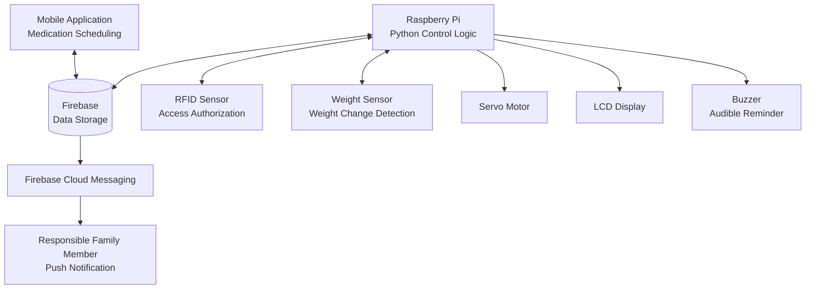

# Smart Medicine Box

An academic embedded systems and mobile application project developed at **ISAMM in 2024**, designed to help patients follow medication schedules and notify a designated family member when a dose may have been missed.

The prototype combines a Raspberry Pi, electronic sensors, a medication reminder mechanism, a mobile application, and Firebase services.

## Key Features

- **Medication scheduling:** Configure medication times through the mobile application.
- **Audible reminders:** Use a buzzer to remind the patient when medication is due.
- **Access authorization:** Use an RFID sensor to check whether access is authorized.
- **Medication-taking detection:** Monitor weight changes to help determine whether medication may have been taken.
- **Family notifications:** Send push notifications to a designated family member through Firebase Cloud Messaging (FCM).
- **Hardware–software integration:** Connect a Raspberry Pi with sensors, a servo motor, an LCD, and the mobile application.

## System Architecture

The diagram below illustrates the main system components and their relationships.

**Communication overview**

- The mobile application and Raspberry Pi communicate with Firebase.
- Python running on the Raspberry Pi handles the hardware-control logic.
- The RFID sensor checks access authorization, while the weight sensor detects changes that may indicate medication removal.
- The buzzer provides an audible reminder, and the LCD provides on-device feedback.
- Firebase Cloud Messaging delivers push notifications to the responsible family member.

*Note: This is a high-level representation. The exact database service and the detailed trigger used to send notifications should be confirmed against the original implementation.*

## Technologies & Components

| Category | Technology or component |
|---|---|
| Controller | Raspberry Pi |
| Programming language | Python |
| Cloud integration | Firebase |
| Push notifications | Firebase Cloud Messaging (FCM) |
| Sensors | RFID sensor, weight sensor |
| Actuation | Servo motor |
| User feedback | LCD, buzzer |
| User interface | Mobile application |

## My Contribution

- Developed the mobile application.
- Worked on Firebase integration and data management.
- Contributed to software development and testing.
- Prepared parts of the technical documentation.

## Project Resources

- **Technical report:** [Read the project report](docs/Smart_Medicine_Box.pdf)
- **Application demonstration:** [Watch the demonstration]( System Demo & Logs Demonstration notes and video references for the Smart Pill Box system)
- **Source code:** Browse the files in this repository.

Replace `YOUR_VIDEO_LINK` with the actual shareable video URL. Make sure the report filename and capitalization match the file in the `docs` folder.

## Future Improvements

Potential areas for further development include:

- Improving the accuracy of medication-taking detection.
- Strengthening notification reliability and error handling.
- Improving the mobile interface's accessibility.
- Enhancing security and access control.
- Expanding end-to-end testing across the hardware, mobile app, and cloud services.

These are possible improvements, not features claimed to be completed in the original project.

## Project Information

- **Institution:** ISAMM, Tunisia
- **Year:** 2024
- **Project type:** Academic engineering project
- **Team members:** Touka Juini, Yosr Laaouti, Farah Htira

**Disclaimer:** This project was developed as an academic prototype and is not a certified medical device.

**Areas of focus:** Embedded Systems · IoT · Python · Mobile Application Development · Firebase · Hardware–Software Integration
