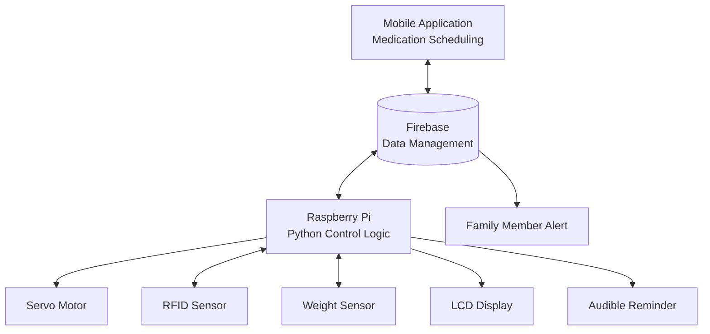

# Smart Medicine Box

**An embedded systems and mobile application project for medication reminders and family notifications.**

An academic engineering project developed at ISAMM in 2024, combining a Raspberry Pi, electronic sensors, a mobile application, and Firebase integration.

The system is designed to help patients follow medication schedules through audible reminders and alerts to a designated family member when a scheduled dose is not taken as expected.

## Project Highlights

- **Medication scheduling:** Configure medication times through the mobile application.
- **Audible reminders:** Use a buzzer to remind patients when medication is due.
- **Family notifications:** Alert a designated responsible family member when the system detects a missed dose, according to the implemented logic.
- **Hardware integration:** Combine a Raspberry Pi with a servo motor, RFID sensor, weight sensor, and LCD.
- **Cloud integration:** Use Firebase for application data management and communication.

## System Architecture

The following diagram illustrates the intended high-level system structure. Confirm the actual communication paths against your implementation.

## Hardware & Software

| Category | Components |
|---|---|
| Controller | Raspberry Pi |
| Actuation | Servo motor |
| Sensors | RFID sensor, weight sensor |
| User feedback | LCD, buzzer |
| Programming language | Python |
| Backend integration | Firebase |
| Mobile interface | Medication scheduling and notifications |

## My Contribution

My work focused on the software and integration aspects of the project.

- Developed the mobile application.
- Worked on Firebase integration and data management.
- Contributed to software development and testing.
- Prepared parts of the technical documentation.

## Demonstration & Documentation

- **Application demo:** [Watch the demonstration](YOUR_VIDEO_LINK)
- **Technical report:** [Read the project report](docs/Smart_Pill_Box_Report.pdf)
- **Source code:** Browse the files in this repository.

## Current Status & Future Improvements

The prototype reached the implementation stage documented during the university project in 2024. Further development was outside the scope of the available project work.

Potential improvements include:

- Improving the mobile interface and accessibility.
- Testing dispensing reliability and sensor accuracy.
- Strengthening notification reliability and failure handling.
- Improving system security and access control.
- Expanding integration and end-to-end testing.

These improvements are proposed future work, not features claimed to be completed.

## Project Information

- **Institution:** ISAMM
- **Year:** 2024
- **Type:** Academic engineering project
- **Team members:** Touka Juini, Yosr Laaouti, Farah Htira

---

*Academic prototype for demonstrating embedded systems, mobile application development, and hardware–software integration. Not a certified medical device.*
